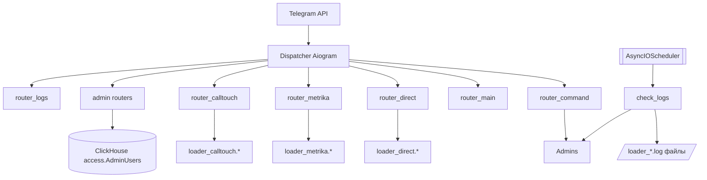
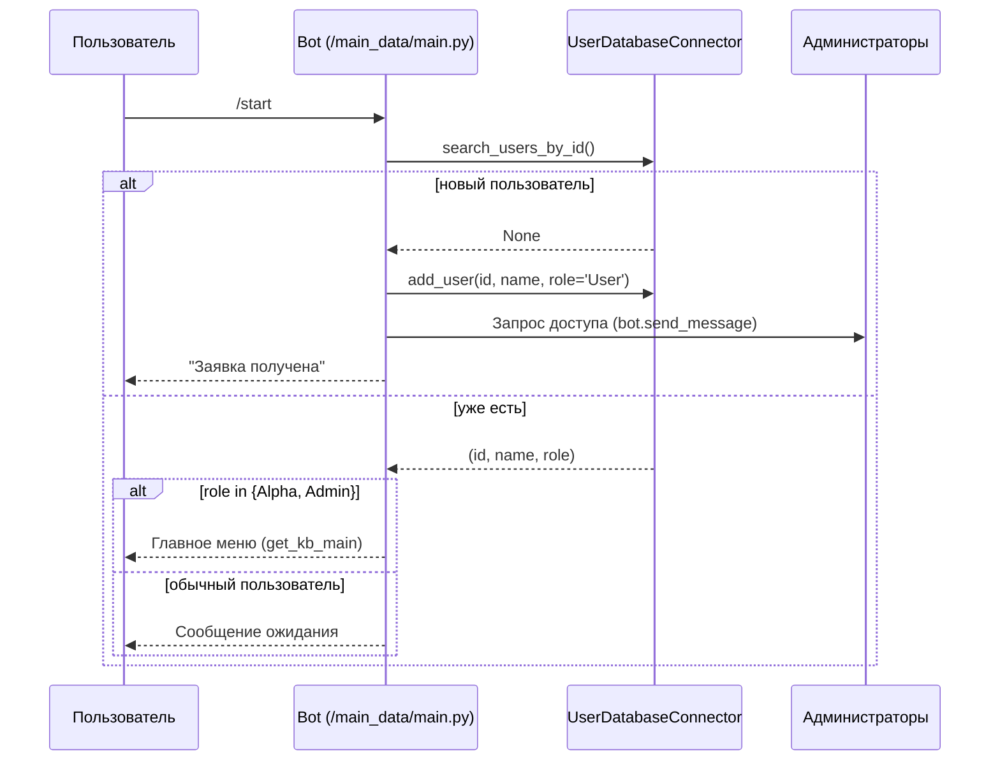

<p align="center">
  
</p>

# Система загрузки рекламных и аналитических данных

Оркестрации и управления потоками данных из рекламных и аналитических систем (Яндекс.Директ, Яндекс.Метрика, Calltouch, VK Ads) в ClickHouse с использованием Prefect 3 и интеграцией Telegram-бота для администрирования.

## Содержание

- [Архитектура системы](#архитектура-системы)
- [Основные компоненты](#основные-компоненты)
- [Быстрый старт](#быстрый-старт)
- [Конфигурация](#конфигурация)
- [Администрирование через Telegram](#администрирование-через-telegram)
- [Деплойменты и расписание](#деплойменты-и-расписание)
- [Модульность системы](#модульность-системы)
- [Change Tracking](#change-tracking)
- [Добавление нового коннектора](#добавление-нового-коннектора)
- [Сообщество](#сообщество)

---

## Архитектура системы

| Слой | Компонент | Описание |
|------|-----------|----------|
| **Источники** | Яндекс.Директ, Яндекс.Метрика, Calltouch, VK Ads | Внешние API |
| **Коннекторы** | `connectors/` | Асинхронные загрузчики с rate limiting и change tracking |
| **Оркестрация** | Prefect Server + Worker | Планирование, retry-логика, мониторинг (UI на порту 4200) |
| **Хранилище** | ClickHouse | Колоночная БД; `loader.Accesses` — централизованное хранилище токенов |
| **Администрирование** | Telegram Bot | Управление клиентами, запуск задач, уведомления об ошибках |

### Поток данных

1. **Планирование**: Prefect Server по расписанию (cron) или по требованию запускает flow
2. **Change Tracking**: сравниваются агрегаты API с данными в ClickHouse, определяются дни для перезагрузки
3. **Параллельная загрузка**: worker'ы выполняют задачи с соблюдением лимитов API
4. **Запись в ClickHouse**: удаление устаревших записей за обновляемый период, затем batch-вставка

---

## Основные компоненты

### Коннекторы (`connectors/`)

Каждый коннектор содержит подробный README с описанием структуры, схемы таблиц, параметров и инструкцией по запуску:

| Коннектор | Описание | README |
|-----------|----------|--------|
| `direct_loader` | Статистика кампаний Яндекс.Директ (Reporting API), два профиля: analytics и light | [README](#rodl-direct) |
| `metrika_loader` | Логи визитов Яндекс.Метрики (Logs API + Reporting API), change tracking по дням | [README](#rodl-metrika) |
| `calltouch_loader` | Звонки и заявки Calltouch (Calls Diary API + Requests API) | [README](#rodl-calltouch) |
| `vk_loader` | Статистика рекламных кампаний VK Ads, агентские аккаунты | [README](#rodl-vk) |

### Prefect (`orchestration/`)

- **prefect-server**: веб-интерфейс и API на порту 4200
- **prefect-db**: PostgreSQL для метаданных Prefect
- **prefect-bootstrap**: создаёт деплойменты при старте
- **prefect-agent**: выполняет запланированные задачи

### ClickHouse

Базы данных: `loader`, `loader_direct_analytics`, `loader_direct_light`, `loader_metrika`, `loader_calltouch`, `loader_vk`.

Таблица `loader.Accesses` централизованно хранит все токены доступа к API:

```sql
CREATE TABLE loader.Accesses (
    login     Nullable(String),   -- логин клиента или идентификатор
    token     Nullable(String),   -- OAuth-токен доступа
    container Nullable(String),   -- числовое значение, например номер контейнера/аккаунта
    type      Nullable(String)    -- тип сервиса (direct, metrika, metrika:agency, vk, ...)
) ENGINE = MergeTree
ORDER BY (type, container, login);
```

#### Пользователи ClickHouse

| Пользователь | Переменные окружения | Привилегии |
|---|---|---|
| `default_user` | `CLICKHOUSE_USER` / `CLICKHOUSE_PASSWORD` | SELECT, INSERT, ALTER, CREATE, TRUNCATE, SHOW TABLES на всех базах данных с данными; ACCESS MANAGEMENT на уровне сервера. Доступ к таблице `Accesses` **закрыт**. |
| `access_user` | `CLICKHOUSE_ACCESS_USER` / `CLICKHOUSE_ACCESS_PASSWORD` | SELECT, INSERT, ALTER, CREATE, TRUNCATE, SHOW TABLES только на `loader.Accesses` и `loader.AdminUsers`. Доступ к базам данных с данными **закрыт**. |
| `default` (admin) | `CLICKHOUSE_ADMIN_PASSWORD` | Стандартный административный пользователь ClickHouse. Используется только при инициализации контейнера (`init.sh`). В рабочем процессе не применяется. |

### Telegram Admin Bot (`admin_bot/`)

Административный интерфейс на базе Aiogram 3:
- Управление токенами для всех коннекторов
- Запуск загрузок через Prefect API (точечно или массово)
- Автоматические уведомления о падениях flow (FAILED, CRASHED, CANCELLED)
- Система ролей: User → Alpha → Admin

---

## Быстрый старт

**1. Клонирование:**
```bash
git clone https://github.com/QuestGuideRF/rodl.git && cd rodl
```

**2. Настройка окружения:**
```bash
cp .env.example .env
# Отредактируйте .env
```

**3. Запуск:**
```bash
docker compose up -d
```

Запустится ClickHouse, Prefect Server (http://localhost:4200), Prefect Worker, Bootstrap и Telegram Bot.

**4. Добавление токенов** — через Telegram-бот (раздел нужного коннектора).

**5. Первая загрузка** — через Prefect UI (Deployments → Run) или через бот.

---

## Конфигурация

### `config/loaders.yaml`

Единый файл конфигурации: статус загрузчиков и имена баз данных.

```yaml
databases:
  default: loader
  access: loader

loaders:
  direct_loader:
    enabled: true
    display_name: "💰 Яндекс.Директ"
    databases:
      direct_analytics: loader_direct_analytics
      direct_light: loader_direct_light
  metrika_loader:
    enabled: true
    display_name: "📊 Яндекс.Метрика"
    databases:
      metrika: loader_metrika
  calltouch_loader:
    enabled: true
    display_name: "📞 Calltouch"
    databases:
      calltouch: loader_calltouch
  vk_loader:
    enabled: true
    display_name: "🎯 VK Ads"
    databases:
      vk: loader_vk
```

Чтобы отключить загрузчик — `enabled: false`. Имена БД настраиваются в `databases`.

### Переменные окружения (`.env`)

Скопируйте `.env.example` → `.env` и заполните значения.

#### ClickHouse

| Переменная | Описание |
|------------|----------|
| `CLICKHOUSE_USER` | Основной пользователь для работы с таблицами данных (SELECT, INSERT, ALTER, CREATE, TRUNCATE). Создаётся автоматически при старте контейнера. |
| `CLICKHOUSE_PASSWORD` | Пароль основного пользователя. |
| `CLICKHOUSE_ACCESS_USER` | Пользователь только для таблицы `loader.Accesses`. Используется ботом и коннекторами при чтении токенов. Минимальные привилегии. |
| `CLICKHOUSE_ACCESS_PASSWORD` | Пароль пользователя доступа. |
| `CLICKHOUSE_ADMIN_PASSWORD` | Пароль административного пользователя ClickHouse. Нужен только при инициализации контейнера — в работе системы не участвует. |
| `CLICKHOUSE_HOST` | Хост ClickHouse. Внутри Docker Compose — имя сервиса `clickhouse`. Для внешнего подключения — IP или hostname хоста. |
| `CLICKHOUSE_PORT` | HTTP-порт ClickHouse (по умолчанию `8123`). |

#### PostgreSQL (Prefect)

| Переменная | Описание |
|------------|----------|
| `PREFECT_DB_USER` | Пользователь PostgreSQL для Prefect. |
| `PREFECT_DB_PASSWORD` | Пароль пользователя PostgreSQL. |
| `PREFECT_DB_NAME` | Имя базы данных PostgreSQL. Хранит метаданные Prefect: flow runs, деплойменты, расписания. |

#### Система

| Переменная | Описание |
|------------|----------|
| `TZ` | Временная зона. Влияет на cron-расписания в `connectors/*/prefect/prefect.yaml`. Допустимые значения: [список TZ](https://en.wikipedia.org/wiki/List_of_tz_database_time_zones). |
| `PREFECT_API_URL` | URL Prefect API. `http://localhost:4200/api` — для обращений с хост-машины (CLI, браузер). Внутри контейнеров используется `http://prefect-server:4200/api` — это значение подставляется через `docker-compose.yml` автоматически. |

#### Telegram Bot

| Переменная | Описание |
|------------|----------|
| `ADMIN_BOT_TOKEN` | Токен Telegram-бота. Получается у [@BotFather](https://t.me/BotFather) → `/newbot`. |
| `ADMIN_REGISTRATION_CODE` | Секретный код для первичной регистрации администратора. Первый пользователь отправляет боту `/reg <код>` и получает роль Admin. Рекомендуется использовать случайную строку: `openssl rand -hex 16`. |

---

## Администрирование через Telegram

### Роли пользователей

| Роль | Доступные функции |
|------|-------------------|
| `User` | Нет доступа. После `/start` отправляется уведомление всем администраторам с Telegram ID и именем пользователя. |
| `Alpha` | Доступ только к выгрузке данных в коннекторах, где она настроена (`💾 Выгрузка`). Админ-панель и управление токенами/клиентами недоступны. |
| `Admin` | Всё, что доступно Alpha. Дополнительно: управление пользователями (добавить/снять роль Admin или Alpha), массовый запуск загрузки всех коннекторов, экспорт и импорт резервной копии таблицы `Accesses`, очистка устаревших клиентов, полный сброс базы данных. Получает автоматические уведомления об ошибках Prefect. |

**Первичная регистрация администратора:**

1. Отправить боту `/start` (создаётся запись с ролью `User`)
2. Отправить `/reg <код>` — роль повышается до `Admin`

Код берётся из переменной `ADMIN_REGISTRATION_CODE`. Последующих администраторов добавляет действующий Admin через `/a → Добавить администратора`.

### Команды

- `/start` — регистрация / вход в главное меню
- `/reg <код>` — первичная регистрация администратора
- `/a` — панель администратора (только для роли Admin; для `Alpha` команда недоступна)

### Управление токенами

Токены добавляются через раздел нужного коннектора в боте. Типы токенов и форматы ввода описаны в README каждого коннектора.

### Мониторинг

Бот автоматически опрашивает Prefect API каждые 35 минут (настраивается через `LOG_CHECK_INTERVAL`). При обнаружении flow runs в состоянии `FAILED`, `CRASHED` или `CANCELLED` отправляет уведомление всем администраторам.

---

## Деплойменты и расписание

Prefect-деплойменты определены в `connectors/<loader>/prefect/prefect.yaml` и создаются автоматически при старте `prefect-bootstrap` для включённых (`enabled: true`) коннекторов из `config/loaders.yaml`. Расписание, параметры и инструкция по ручному запуску — в README каждого коннектора.

---

## Модульность системы

Система построена вокруг модулей коннекторов: всё, что относится к конкретному источнику данных, лежит внутри `connectors/<loader>/`.

### Что входит в модуль коннектора

- `prefect/flows.py` и `prefect/prefect.yaml` — оркестрация и расписание.
- `prefect/clickhouse_utils.py` — ClickHouse-адаптер коннектора.
- `bot/` и `bot/admin/` (опционально) — пользовательские и админские хендлеры бота.
- `bot/plugin.py` — декларативное подключение коннектора в общий бот.
- `loader_service.py`, `access.py`, `tasks.py` и т.д. — доменная логика.

### Плюсы системы

- Включение/выключение коннектора через `config/loaders.yaml` без правок в ядре.
- Минимум конфликтов: каждый коннектор работает в своей папке.
- Быстрый перенос: можно делиться коннектором как отдельным модулем.
- Простое масштабирование: новые коннекторы добавляются по единому шаблону.

### Краткий гайд по новому коннектору

1. Создайте `connectors/my_loader/` и базовую бизнес-логику (`loader_service.py`, `access.py`).
2. Добавьте `connectors/my_loader/prefect/flows.py`, `connectors/my_loader/prefect/prefect.yaml`, `connectors/my_loader/prefect/clickhouse_utils.py`.
3. Добавьте bot-интеграцию: `connectors/my_loader/bot/handlers.py`, `.../keyboards.py`, `.../plugin.py` (и `bot/admin/` при необходимости).
4. Зарегистрируйте коннектор в `config/loaders.yaml` (`enabled`, `display_name`, `databases`).
5. Пересоздайте деплойменты: `docker compose restart prefect-bootstrap`.
6. Проверьте, что коннектор появился в Telegram-боте и его deployment создан в Prefect.

---

## Change Tracking

Ключевая функция системы: перезагружаются только те дни, где данные в ClickHouse расходятся с API.

**Алгоритм:**
1. Определить окно дат (сегодня − `lookback_days` ... вчера)
2. Запросить агрегаты из API и из ClickHouse
3. Сравнить построчно — если метрика отличается, день добавляется в список
4. Сгруппировать изменённые даты в непрерывные диапазоны
5. Удалить данные за эти диапазоны, загрузить свежие из API

**Параметры:**

| Параметр | По умолчанию | Описание |
|----------|-------------|----------|
| `lookback_days` | 60 | Глубина проверки в днях |
| `cost_tolerance` | 500 / 2 | Допустимое отклонение стоимости (только Direct: analytics / light) |
| `compare_conversions` | true | Сравнивать ли конверсии |

**Когда не использовать:** первичная загрузка исторических данных, полная перезагрузка после изменения структуры — в этих случаях задавайте явный `start_date`/`end_date`.

---

## Безопасность


## Лицензия

Проект распространяется по лицензии GNU AGPLv3; условия опубликованы в [исходном репозитории RoDL](https://github.com/Naxofon/RoDL).

## Сообщество

- [Присоединяйтесь в сообщество](https://t.me/help_rodl) — актуальные вопросы, помощь и поддержка

## Справочник по компонентам

<a id="rodl-admin-bot"></a>

<details>
<summary>Telegram-бот администрирования</summary>

Telegram‑бот для администраторов Make Digital, который управляет доступами пользователей, конфигурациями клиентов в разных сервисах (Yandex.Metrica, Yandex.Direct, Calltouch), а также отслеживает ошибки рабочих пайплайнов по лог‑файлам. Проект построен на **Aiogram 3**, **APScheduler** и асинхронных драйверах БД.

### Основные возможности
- Регистрация и авторизация пользователей через `/start` с автоматической рассылкой запросов доступа администраторам (`main_data/command.py`).
- Панель управления (инлайн‑клавиатуры из `main_data/keyboard.py`) для доменов: Metrika, Direct.
- Админ‑панель умеет запускать change tracker Метрики и Директа сразу по всем клиентам.
- Работа с ролями и правами в ClickHouse (таблица `AdminUsers` в БД `access`, заданной в `loaders.yaml`): роли `User`, `Alpha`, `Admin`.
- Управление конфигурациями клиентов во внешних БД (`loader_*`) через специализированные роутеры.
- Отправка CSV/текстовых отчётов прямо в Telegram и запуск интеграций (change tracker, pipe) из чатов.
- Фоновый мониторинг логов через `APScheduler` и автоматические уведомления об ошибках (`main_data/logs_handler.py`).

### Архитектура



### Структура репозитория

Проект следует принципам чистой архитектуры с разделением ответственности:

```
admin_bot/
├── app.py                    # Точка входа приложения
├── config/
│   ├── __init__.py
│   └── settings.py          # Настройки из .env (токены, деплойменты и т.д.)
├── handlers/                 # Обработчики команд и callback'ов
│   ├── __init__.py
│   ├── commands.py          # /start, /a, /reg
│   ├── callbacks.py         # Обработчики главного меню
│   ├── direct.py            # Yandex.Direct FSM обработчики
│   ├── metrika.py           # Yandex.Metrika FSM обработчики
│   └── logs.py              # Мониторинг логов
├── admin/
│   ├── handlers.py          # Админ-панель (управление пользователями, bulk uploads)
│   └── keyboards.py         # Клавиатуры админ-панели
├── keyboards/
│   ├── __init__.py
│   └── inline.py            # Inline-клавиатуры
├── database/
│   ├── __init__.py
│   └── user.py              # ClickHouse коннектор для пользователей
├── services/
│   ├── __init__.py
│   └── prefect_client.py    # Интеграция с Prefect API
└── logs/                     # Логи бота (создаётся автоматически)
```

> В проекте предполагается наличие соседних пакетов `loader_direct`, `loader_metrika`, `loader_calltouch`, `loader_custom_pipe`, `loader_vk` (см. абсолютные пути в коде). Они должны лежать рядом с репозиторием (`/home/make/dirloader_base/...`) или быть доступны через `PYTHONPATH`.

### Логика и связи

#### Поток авторизации



- `/a` открывает админ‑панель только для `Admin`. Остальным пользователям отправляется запрос доступа администраторам (тот же механизм рассылки).
- Переходы между разделами выполняются через callback data `command_*`, обрабатываются в `main_data/main_handlers.py`.

#### Основные роутеры и их обязанности

| Роутер | Файл | Основные методы/состояния | Особенности |
| --- | --- | --- | --- |
| `router_command` | `main_data/command.py` | `/start`, `/a`, `/reg` | Регистрация пользователей в ClickHouse (AdminUsers в БД access из `loaders.yaml`) и выдача клавиатур. Одноразовая регистрация администратора через код. |
| `router_main` | `main_data/main_handlers.py` | `command_*` callbacks | Переключение между разделами (главное меню, админ‑панель, домены). |
| `router_direct` | `main_data/direct_handlers.py` | `AddDirectClient`, `RemoveDirectClient`, `UpdateDataDirectClient` | Объединяет секреты/модули `loader_direct` и `loader_metrika`, запускает change tracker по логину. |
| `router_metrika` | `main_data/metrika_handlers.py` | `MetrikaStates` (`add/remove/update`) | Управление таблицей конфигураций метрики, генерация CSV, запуск change tracker по счётчику. |
| `router_calltouch` | `main_data/calltouch_handlers.py` | `CalltouchStates` (`add/remove/update`) | Работает с `AsyncCalltouchDatabase`, запускает pipe `process_single_client(site_id, tdelta)`. |
| `router_logs` | `main_data/logs_handler.py` | `/lgs`, `/lgs_res`, `check_logs()` | Читает внешние логи и уведомляет админов при `Error`. |
| `router_admin_*` | `admin/handlers.py` | FSM по добавлению/удалению ролей | Используют `UserDatabaseConnector` для смены ролей. |

#### Prefect интеграция для массовых выгрузок

- Запуски из админ‑бота выполняются **только через Prefect**; локальный fallback отключён.
- Укажите деплойменты через переменные окружения (опционально — иначе будут использованы стандартные имена деплойментов):
  - `PREFECT_DEPLOYMENT_METRIKA_ALL` — деплоймент `metrika_loader_flow` с параметром `track_changes=True` (по умолчанию используется `metrika-loader-clickhouse/metrika-loader-clickhouse`).
  - `PREFECT_DEPLOYMENT_DIRECT_ALL` — деплоймент `direct_loader_flow` (бот передаёт `profile=analytics|light`; по умолчанию `direct-loader-clickhouse/direct-analytics-change` для analytics и `direct-loader-clickhouse/direct-light-hourly` для light).
  - Опционально `PREFECT_DEPLOYMENT_DIRECT_ANALYTICS` / `PREFECT_DEPLOYMENT_DIRECT_LIGHT` для разных деплойментов.
- Бот помечает такие запуски тегами `admin_bot`, `bulk_upload`. Если деплоймент не настроен или Prefect недоступен, бот сообщит об ошибке и не запустит задачу.

#### Prefect интеграция для точечных выгрузок

- Все точечные обновления (Direct по одному логину, Метрика по одному счётчику) запускаются через Prefect:
  - `PREFECT_DEPLOYMENT_DIRECT_SINGLE` (общий) или раздельные `PREFECT_DEPLOYMENT_DIRECT_SINGLE_ANALYTICS` / `PREFECT_DEPLOYMENT_DIRECT_SINGLE_LIGHT` — деплоймент `direct_loader_flow` с параметрами `track_changes=True`, `profile`, `login` (по умолчанию `direct-loader-clickhouse/direct-analytics-change` или `direct-loader-clickhouse/direct-light-hourly`).
  - `PREFECT_DEPLOYMENT_METRIKA_SINGLE` (или `PREFECT_DEPLOYMENT_METRIKA_ALL` в качестве fallback) — деплоймент `metrika_loader_flow` с `track_changes=True`, `counter_id` (по умолчанию `metrika-loader-clickhouse/metrika-loader-clickhouse`).
- Теги для точечных запусков: `admin_bot`, `single_upload`. При ошибке создания Prefect run бот сообщит об ошибке и не запустит локальный процесс.

#### Хранилища
- **ClickHouse (`AdminUsers` в БД `access`)** — таблица пользователей бота (Telegram ID, имя, роль). Используется для авторизации и прав.
- **Внешние БД** — предоставляются пакетами `loader_direct`, `loader_metrika`, `loader_calltouch`, `loader_custom_pipe`, `loader_vk`.

#### Мониторинг логов
- `main_data/logs_handler.py` содержит `log_files` со списком абсолютных путей к лог‑файлам; при каждом запуске `check_logs()` читаются только новые данные (по смещению `last_size`).
- Каждая строка, содержащая `ERROR|error|Error`, отправляется всем администраторам в HTML (`<pre>…</pre>`).
- Команда `/lgs` отправляет сводку размеров файлов и непрочитанных байтов.
- Команда `/lgs_res` сбрасывает смещения (полезно после ротации логов).

### Методы и сервисы

#### `database/user.py :: UserDatabaseConnector`

| Метод | Параметры | Описание |
| --- | --- | --- |
| `initialize()` | — | Создаёт таблицу ClickHouse при первом запуске. |
| `add_user(user_id, name, role)` | int, str, str | Добавляет запись, если id ещё не существует. |
| `delete_user(user_identifier)` | id либо имя | Удаляет по ID или имени. |
| `get_user_ids_by_role(role)` | str | Возвращает список ID для роли (`Admin`, `Alpha`, `User`). |
| `search_users_by_id(user_id)` | int | Возвращает `(id, name, role)` или `None`. |
| `get_administrators()` / `get_alpha()` | — | Списки словарей `{id, name}`. Используется в админ‑панели для отображения. |
| `set_user_to_admin/alpha/user(user_id)` | int | Переключает роль, фиксируя изменения в БД. |

> Таблица пользователей хранится в ClickHouse (`AdminUsers` в БД `access`) и использует ReplacingMergeTree для обновления ролей.

#### Ключевые обработчики
- `main_data/direct_handlers.py`:
  - `handle_yd_clients` → выгружает CSV со всеми логинами из `AsyncDatabase`.
  - `process_add_yd_client` → ожидает `login token`, нормализует логин, добавляет клиента через `add_other_client_list_to_table`.
  - `process_update_client` → запускает change tracker для выбранного профиля (через Prefect если настроен, иначе локально).
- `main_data/metrika_handlers.py`:
  - `process_add_ym_client` → формат `fact_login counter_metric token`.
  - `process_update_ym_data` → принимает один `counter_metric` и запускает `refresh_data_with_change_tracker`.
- `main_data/calltouch_handlers.py`:
  - `process_add_ch_client` → формат `account site_id token`.
  - `process_update_ch_data` → формат `site_id timedelta`, вызывает `process_single_client`.
- `admin/handlers.py`:
  - `add_new_admin_start_handler` → выводит текущих админов, ожидает ID.
  - `process_remove_admin` → переводит пользователя в роль `User`.
  - `process_add_new_alpha` → повышает до `Alpha`.

### CLI / Форматы аргументов

Проект предоставляет два слоя CLI:

1. **Запуск из терминала** (shell):
   | Команда | Аргументы | Назначение |
   | --- | --- | --- |
   | `python -m venv .venv` | — | Создать виртуальное окружение. |
   | `source .venv/bin/activate` | — | Активировать окружение (Windows: `.venv\Scripts\activate`). |
   | `python -m pip install -r requirements.txt` | `--extra-index-url ...` (опц.) | Установка зависимостей. Файл `requirements.txt` нужно составить согласно разделу «Зависимости». |
   | `PYTHONPATH=".:$PYTHONPATH" python -m main_data.main` | `--log-level=INFO` (стандартный аргумент интерпретатора) | Запуск бота; дополнительные аргументы Python (`-O`, `-X dev`, `-m`) можно использовать по необходимости. |

2. **Интерактивный CLI в Telegram** — каждая операция требует строки с аргументами. Ниже перечислены форматы (регистр не учитывается, аргументы разделяются пробелами):

| Раздел | Callback/Команда | Ожидаемые аргументы | Пример |
| --- | --- | --- | --- |
| Админ‑панель | `add_admin` | `telegram_id` | `523456789` |
| Админ‑панель | `add_alpha` | `telegram_id` | `523456789` |
| Админ‑панель | `remove_admin` | `telegram_id` | `523456789` |
| Metrika | `command_add_ym_clients` | `yandex_login counter_metric token` | `client_login 1234567 y0_example_token` |
| Metrika | `command_remove_ym_clients` | `counter_metric` | `1234567` |
| Metrika | `command_upload_ym_data` | `counter_metric` | `1234567` |
| Direct | `command_add_yd_agent` | `login token [container]` (login можно опустить или `-`; сохраняется как `agency_token`) | `agency-login yandex_auth_token agency-tag` |
| Direct | `command_add_yd_client` | `login token [container]` (login обязателен; сохраняется как `not_agency_token`) | `brand-login yandex_auth_token clients` |
| Direct | `command_remove_yd_clients` | `login` | `brand-login` |
| Direct | `command_upload_yd_data` | 1) выбрать профиль (`direct_profile_analytics` / `direct_profile_light`), 2) `login` | `client-login` |
| Calltouch | `command_add_ch_clients` | `account site_id token` | `brand 166611 secret_token` |
| Calltouch | `command_remove_ch_clients` | `site_id` | `166611` |
| Calltouch | `command_upload_ch_data` | `site_id timedelta_days` | `166611 50` |
| Logs | `/lgs` | — | Получить статус чтения логов. |
| Logs | `/lgs_res` | — | Сбросить позицию чтения логов. |
| Admin | `/reg` | `code` | `/reg your_registration_code` |

### Порядок запуска

1. **Подготовьте окружение**
   - Python 3.10+.
   - Установите внешние пакеты `loader_direct`, `loader_metrika`, `loader_calltouch`, `loader_custom_pipe`, `loader_vk` рядом с проектом либо добавьте их в `PYTHONPATH`.
   - Создайте `.venv` и установите зависимости: `aiogram>=3.2`, `apscheduler`, `clickhouse-connect`, `pandas`, `python-dotenv` (если решите вынести токен из `secret.py`).

2. **Настройте конфиденциальные данные**
   - В корневом `.env` файле установите `ADMIN_BOT_TOKEN` (или `TELEGRAM_BOT_TOKEN`)
   - В `.env` установите `ADMIN_REGISTRATION_CODE` для одноразовой регистрации первого администратора
   - Все настройки загружаются автоматически через `config/settings.py`

3. **Подготовьте БД**
  - Таблица пользователей создаётся скриптом `config/clickhouse_setup/init.sh` (или вручную).
  - Для работы бота нужны права `SELECT`, `INSERT`, `ALTER` на `AdminUsers` в БД `access`.

4. **Проверьте пути логов**
   - Обновите `log_files` в `handlers/logs.py`, если лог‑файлы находятся в других каталогах.

5. **Запустите бота**
   ```bash
   python app.py
   ```
   - По старту бот удаляет webhook (`bot.delete_webhook(drop_pending_updates=True)`) и начинает polling.

### Планировщик и его настройка

- Планировщик создаётся в `app.py` (`scheduler = AsyncIOScheduler()`), запускается в `startup_handler`.
- Текущая задача:
  ```python
  scheduler.add_job(
      check_logs,
      "interval",
      seconds=settings.LOG_CHECK_INTERVAL,  # 2100 секунд (35 минут)
      args=(bot,)
  )
  ```
- **Изменить интервал:** установите переменную окружения `LOG_CHECK_INTERVAL` или отредактируйте значение в `config/settings.py`. После пересохранения перезапустите бота.
- **Добавить задачу:** вызовите `scheduler.add_job(<coroutine>, trigger, **kwargs)` внутри `startup_handler`.
- **Запустить вручную:** импортируйте `check_logs` и выполните `asyncio.run(check_logs(bot))` в отдельном скрипте (бот должен быть авторизован, иначе используйте `Bot(token=...)` для stand‑alone вызова).
- **Отключить:** удалите `scheduler.add_job(...)` или вызовите `scheduler.remove_all_jobs()` до `scheduler.start()`.

### Логи и отладка
- Основной лог бота (`logs/bot.log`) содержит события Aiogram/APScheduler.
- `handlers/logs.py` ведёт мониторинг внешних логов и уведомляет администраторов.
- При отладке интеграций Direct/Metrika полезно смотреть внешние логи (пути заданы в `log_files`).
- Команды `/lgs` и `/lgs_res` доступны только администраторам — проверяется через `UserDatabaseConnector.get_admin_user_ids`.

### Работа с ролями
- Роли `Admin` и `Alpha` получают доступ к основным разделам, `User` видит только сообщение ожидания.
- Добавление/удаление ролей доступно из админ‑клавиатуры (`get_kb_admin`).
- Все операции проходят через FSM — бот явно ожидает ID, пока не завершит сценарий, после чего состояние очищается `state.clear()`.

### Зависимости (минимальный список)
- `aiogram>=3.2`
- `apscheduler>=3.10`
- `clickhouse-connect`
- `pandas`
- `python-dotenv` (если переносите токен в `.env`)

Добавьте необходимые декларации в `requirements.txt` перед установкой.

### Полезные заметки
- Все настройки централизованы в `config/settings.py` и загружаются из `.env`
- Для новых доменов следуйте паттерну: создайте новый файл в `handlers/`, определите FSM состояния, добавьте роутер в `app.py`
- Все токены и секреты хранятся в `.env` файле (никогда не коммитьте их в VCS)
- Структура проекта следует принципам чистой архитектуры с разделением ответственности

</details>

<a id="rodl-calltouch"></a>

<details>
<summary>Коннектор Calltouch</summary>

Коннектор загружает звонки и заявки из Calltouch API, нормализует их и записывает в ClickHouse. Запускается через Prefect по расписанию или вручную.

### Стек и зависимости

- Python 3.10+
- Библиотеки: `asyncio`, `aiohttp`, `pandas`, `numpy`, `prefect`
- ClickHouse (через `clickhouse-connect`)

Зависимости описаны в `orchestration/requirements.txt`.

### Структура

```
connectors/calltouch_loader/
├── loader_service.py            # Основной модуль: загрузка, нормализация, запись в ClickHouse
├── prefect/
│   ├── flows.py                 # Prefect flow для запуска коннектора
│   ├── clickhouse_utils.py      # AsyncCalltouchDatabase
│   └── prefect.yaml             # Deployment и расписание
└── bot/
    ├── handlers.py              # Пользовательские команды Calltouch в боте
    ├── keyboards.py             # Клавиатуры раздела Calltouch
    ├── plugin.py                # Регистрация router/keyboard/admin-кнопки
    └── admin/handlers.py        # Админ-массовая выгрузка Calltouch
```

### Как устроен поток данных

```
Prefect Schedule / Bot
        │
        ▼
calltouch_loader_flow  (connectors/calltouch_loader/prefect/flows.py)
        │
        ├── site_id задан → process_single_client(site_id, tdelta)
        └── site_id не задан → process_all_clients(tdelta)
                │  asyncio.Semaphore(5)
                └── process_data(site_id, api_token, tdelta)
                        │
                        ├── download_call_data()  →  /calls-diary/calls
                        ├── download_lead_data()  →  /requests
                        └── ClickhouseDatabase.write_dataframe(ct_{site_id})
```

1. `process_all_clients` читает список клиентов из `loader.Accesses` (тип `calltouch`).
2. Для каждого клиента запускается `process_data` через `asyncio.Semaphore(5)` (не более 5 одновременно).
3. Параллельно запрашиваются данные звонков и заявок из Calltouch API за период `[вчера - tdelta ... вчера]`.
4. Данные нормализуются, объединяются и записываются в ClickHouse в таблицу `ct_{site_id}`.
5. Перед записью диапазон дат очищается (`delete_between_dates`), чтобы не было дублей.

### Конфигурация клиентов

Клиенты хранятся в таблице `loader.Accesses` (ClickHouse):

| Поле        | Значение                                      |
|-------------|-----------------------------------------------|
| `login`     | `site_id` (строка)                            |
| `token`     | API-токен Calltouch                           |
| `container` | Название аккаунта (опционально)               |
| `type`      | `NULL` (не используется для calltouch)        |

Добавление/удаление клиентов — через Telegram-бот (раздел Calltouch) или напрямую через `AsyncCalltouchDatabase` из `connectors/calltouch_loader/prefect/clickhouse_utils.py`.

### Переменные окружения

Имя базы данных (`loader_calltouch`) настраивается в `config/loaders.yaml`.

### Функции модуля

#### `process_all_clients(tdelta=10)`

Загружает данные для всех клиентов из таблицы `Accesses`. Запускает параллельную обработку с ограничением 5 одновременных клиентов.

#### `process_single_client(site_id, tdelta=10, api_token=None)`

Загружает данные для одного клиента. Если `api_token` не передан, берёт токен из `Accesses`.

#### `process_data(site_id, api_token, tdelta=10, db=None)`

Ядро пайплайна:
1. Вычисляет диапазон: `date_from = вчера - tdelta`, `date_to = вчера`.
2. Параллельно запрашивает звонки (`download_call_data`) и заявки (`download_lead_data`).
3. Нормализует и объединяет данные.
4. Очищает и записывает результат в таблицу `ct_{site_id}`.

#### `download_call_data(session, api_token, site_id, date_from, date_to, ...)`

Пагинированный запрос к `/calls-diary/calls`. Формат дат: `DD/MM/YYYY`. Поддерживает параметры `with_call_tags`, `with_comments`, `with_map_visits`.

#### `download_lead_data(session, api_token, site_id, date_from, date_to)`

Запрос к `/requests`. Формат дат: `MM/DD/YYYY` (особенность Calltouch API).

### Схема итоговой таблицы `ct_{site_id}`

| Колонка            | Тип      | Описание                                     |
|--------------------|----------|----------------------------------------------|
| `Date`             | DateTime | Дата и время звонка/заявки                   |
| `tag_category`     | String   | Категории тегов (через запятую)              |
| `tag_type`         | String   | Типы тегов                                   |
| `tag_names`        | String   | Названия тегов                               |
| `additionalTags`   | String   | Дополнительные теги                          |
| `comment_text`     | String   | Первый комментарий из массива                |
| `manager`          | String   | Менеджер                                     |
| `attribution`      | Int64    | Модель атрибуции                             |
| `uniqTargetRequest`| Bool     | Уникальная целевая заявка                    |
| `uniqueRequest`    | Bool     | Уникальная заявка                            |
| `targetRequest`    | Bool     | Целевая заявка                               |
| `uniqueCall`       | Bool     | Уникальный звонок                            |
| `targetCall`       | Bool     | Целевой звонок                               |
| `uniqTargetCall`   | Bool     | Уникальный целевой звонок                    |
| `callbackCall`     | Bool     | Обратный звонок                              |
| `CallSuccessful`   | Bool     | Звонок состоялся                             |
| `CallDuration`     | Int64    | Длительность звонка (секунды)                |
| `subject`          | String   | Тема обращения                               |
| `requestId`        | Int64    | ID заявки                                    |
| `sessionId`        | Int64    | ID сессии                                    |
| `callId`           | Int64    | ID звонка                                    |
| `yaClientId`       | String   | Яндекс ClientID                              |
| `city`             | String   | Город                                        |
| `browser`          | String   | Браузер                                      |
| `device`           | String   | Устройство                                   |
| `os`               | String   | Операционная система                         |
| `keywords`         | String   | Ключевое слово                               |
| `ref`              | String   | Реферер                                      |
| `url`              | String   | URL страницы                                 |
| `source`           | String   | Источник трафика                             |
| `medium`           | String   | Канал трафика                                |
| `utmTerm`          | String   | UTM Term                                     |
| `utmContent`       | String   | UTM Content                                  |
| `utmCampaign`      | String   | UTM Campaign                                 |
| `domain`           | String   | Домен (извлекается из `url`)                 |

Описание полей API: [Calltouch API Docs](https://www.calltouch.ru/support/api/)

### Деплоймент Prefect

Определён в `connectors/calltouch_loader/prefect/prefect.yaml`:

```yaml
- name: calltouch-loader-clickhouse
  entrypoint: connectors/calltouch_loader/prefect/flows.py:calltouch_loader_flow
  schedule:
    cron: "0 8 * * *"
    timezone: Asia/Novosibirsk
  parameters:
    tdelta: 10
```

Запускается ежедневно в 08:00 по Новосибирску. По умолчанию загружает данные за последние 10 дней для всех клиентов.

#### Параметры flow

| Параметр  | Тип            | По умолчанию | Описание                                         |
|-----------|----------------|--------------|--------------------------------------------------|
| `site_id` | `int \| None`  | `None`       | Загрузить только этот клиент (иначе — все)       |
| `tdelta`  | `int`          | `10`         | Глубина перезаливки в днях                       |

#### Retry-логика

- Задачи: 2 повтора с задержкой 25 секунд
- Таймаут для всех клиентов: 4 часа
- Таймаут для одного клиента: 2 часа

### Запуск вручную

**Через Prefect UI:**
1. Откройте http://localhost:4200
2. Deployments → `calltouch-loader-clickhouse`
3. Run → Quick run (все клиенты) или укажите `site_id`

**Через Telegram-бот:**
1. Раздел Calltouch → "Обновить данные"
2. Выберите "Все клиенты" или введите `site_id`

</details>

<a id="rodl-direct"></a>

<details>
<summary>Коннектор Яндекс Директа</summary>

Коннектор загружает статистику рекламных кампаний из API Яндекс.Директ в ClickHouse. Поддерживает два профиля данных (`analytics` и `light`), change tracking и параллельную обработку клиентов. Запускается через Prefect 3 по расписанию или вручную.

### Стек и зависимости

- Python 3.10+
- Библиотеки: `asyncio`, `aiohttp`, `pandas`, `prefect`
- ClickHouse (через `clickhouse-connect`)

Зависимости описаны в `orchestration/requirements.txt`.

### Структура файлов

```
connectors/direct_loader/
├── config.py                # Профили данных, списки полей, типы токенов, rate limiters
├── access.py                # Получение и обновление токенов клиентов из Accesses
├── uploader.py              # YaStatUploader — загрузка отчётов из API и запись в ClickHouse
├── change_tracker.py        # DirectChangeTracker — обнаружение изменённых дней
├── tasks.py                 # Async-функции верхнего уровня
├── jobs.py                  # DirectReloadJob, plan_direct_reload_jobs
├── shared_utils.py          # Нормализация логина, даты, emit_prefect_event
├── report_limits.py         # GlobalRateLimiter, PerAdvertiserRateLimiter, OfflineReportTracker
├── logging_utils.py         # get_logger() — Prefect-логгер
├── prefect/
│   ├── flows.py             # Prefect flow и tasks-обёртки
│   ├── clickhouse_utils.py  # AsyncDirectDatabase
│   └── prefect.yaml         # Deployment и расписания
└── bot/
    ├── handlers.py          # Пользовательские команды Директа
    ├── keyboards.py         # Клавиатуры раздела
    ├── plugin.py            # Регистрация router/keyboard/admin-кнопки
    └── admin/handlers.py    # Админ-массовые выгрузки
```

### Поток данных

```
Prefect / Telegram Bot
        │
        ▼
direct_loader_flow  (connectors/direct_loader/prefect/flows.py)
        │
        ├── track_changes=True
        │       ├── get_direct_clients_task()
        │       ├── detect_changes_for_client_task() × N клиентов (параллельно)
        │       └── fetch_direct_range_task() / write_direct_range_task() × N задач
        │
        └── track_changes=False  (явный диапазон дат)
                └── run_direct_range()
                        └── unload_data_by_day_for_all_clients()
                                └── Pool(cpu_count) → YaStatUploader.unload_data_by_days()
```

### Конфигурация клиентов

Клиенты хранятся в `loader.Accesses` (ClickHouse):

| Поле        | Значение для Direct                                                          |
|-------------|------------------------------------------------------------------------------|
| `login`     | Логин клиента (с `_` вместо `-`) или `-` для агентского токена               |
| `token`     | OAuth-токен Яндекс.Директ                                                    |
| `container` | Название агентства / источника                                               |
| `type`      | `agency_token` / `agency_parsed` / `not_agency_token`                        |

Типы токенов:
- `agency_token` — агентский токен; при каждом запуске система автоматически получает список клиентов через `agencyclients` и сохраняет их с типом `agency_parsed`
- `agency_parsed` — клиент, найденный через агентский аккаунт
- `not_agency_token` — токен конкретного клиента без агентского доступа

Управление токенами — через Telegram-бот (раздел Директ) или напрямую через `AsyncDirectDatabase` из `connectors/direct_loader/prefect/clickhouse_utils.py`.

### Переменные окружения

Все переменные задаются в `.env` корня проекта (см. `.env.example`):

```bash
CLICKHOUSE_HOST=clickhouse
CLICKHOUSE_PORT=8123
CLICKHOUSE_USER=default_user
CLICKHOUSE_PASSWORD=strong_password

CLICKHOUSE_ACCESS_USER=access_user
CLICKHOUSE_ACCESS_PASSWORD=access_password
```

Имена баз данных (`loader_direct_analytics`, `loader_direct_light`) настраиваются в `config/loaders.yaml`.

### Профили данных

#### analytics

Полный профиль (база `loader_direct_analytics`):

| Поле                      | Тип    |
|---------------------------|--------|
| `Date`                    | date   |
| `Criterion`               | str    |
| `AdFormat`                | str    |
| `AdId`                    | int    |
| `CampaignType`            | str    |
| `CampaignName`            | str    |
| `AdGroupName`             | str    |
| `Clicks`                  | int    |
| `Ctr`                     | float  |
| `Cost`                    | float  |
| `Impressions`             | int    |
| `Conversions`             | int    |
| `AvgImpressionPosition`   | float  |
| `AvgPageviews`            | float  |
| `AvgClickPosition`        | float  |
| `Bounces`                 | int    |
| `Age`                     | str    |
| `Gender`                  | str    |
| `Device`                  | str    |
| `LocationOfPresenceName`  | str    |
| `Sessions`                | int    |
| `Slot`                    | str    |
| `Placement`               | str    |
| `AdNetworkType`           | str    |
| `AvgTrafficVolume`        | float  |
| `Conv_*` (цели)           | int    |
| `SumConversion`           | int    |

- `cost_tolerance`: 500 (допуск при сравнении стоимости в change tracker)

#### light

Упрощённый профиль (база `loader_direct_light`):

Поля: `Date`, `CampaignType`, `CampaignName`, `AdGroupName`, `Clicks`, `Conversions`, `Cost`, `Impressions`, `Bounces`, `Sessions`, `Placement`, `AdNetworkType`, `Conv_*`, `SumConversion`

- `cost_tolerance`: 2

### Основные компоненты

#### `YaStatUploader` (`uploader.py`)

Один экземпляр = один клиент + один профиль + один диапазон дат.

| Метод | Описание |
|-------|----------|
| `get_client_list()` | Получает список логинов агентских клиентов через `/json/v5/agencyclients` |
| `upload_data()` | Запрашивает отчёт `CUSTOM_REPORT` через `/json/v5/reports`, обрабатывает ответы 200/201/202/400/9000, записывает в ClickHouse |
| `unload_data_by_days()` | Дробит диапазон на 5-дневные отрезки и вызывает `upload_data()` для каждого |

Особенности `upload_data()`:
- Цели (`GoalId`) запрашиваются через `get_goal_ids_by_client`; GoalId 12 исключается
- Цели делятся на батчи по 10; каждый батч — отдельный отчёт
- 6 попыток с экспоненциальным backoff (5–300 сек)
- Если отчёт не готов за 10 минут или обрывается поток — автоматический переход к поdённым срезам (`fetch_daily_slices`)
- Конверсионные колонки (`Conv_*`) суммируются в `SumConversion`

#### `DirectChangeTracker` (`change_tracker.py`)

Сравнивает агрегаты API с данными в ClickHouse.

| Метод | Описание |
|-------|----------|
| `detect_changes(client_login)` | Возвращает `{"changes_detected": bool, "days_to_update": ["YYYY-MM-DD", ...]}` |
| `get_report_data_for_period(...)` | Запрашивает агрегаты API за период (Impressions, Clicks, Cost, Conversions) |
| `_fetch_report_slice(...)` | Один HTTP-запрос к `/json/v5/reports`; ждёт готовности до 60 попыток по 10 сек |

Алгоритм `detect_changes`:
1. Окно сравнения: последние `lookback_days` дней до вчера
2. Запрашивает агрегаты из API и ClickHouse
3. По каждому дню сравнивает Impressions, Clicks, Cost (с `cost_tolerance`), Conversions
4. Если обнаружены новые конверсионные колонки — автоматически добавляет пустые столбцы в таблицу или помечает дни для перезагрузки
5. Если таблица не существует — форсирует загрузку вчерашнего дня

Параметры:
- `lookback_days` (по умолчанию 60)
- `compare_conversions` (True — сравнивать конверсии)
- `cost_tolerance` (из профиля: 500 / 2)
- `skip_cost_check_clients`: `{"lovol_russia", "changan_asmoto_ads"}` — клиенты, для которых стоимость не сравнивается

#### `access.py`

| Функция | Описание |
|---------|----------|
| `refresh_agency_clients(access_db, profile)` | Для каждого `agency_token` запрашивает список клиентов и обновляет `Accesses` с типом `agency_parsed` |
| `collect_direct_login_tokens(access_db, profile)` | Возвращает `dict[login → token]` с учётом приоритетов типов токенов |

#### `jobs.py`

| Элемент | Описание |
|---------|----------|
| `DirectReloadJob` | Датакласс: `login`, `token`, `start_date`, `end_date`, `profile`, `source` |
| `plan_direct_reload_jobs(...)` | Запускает change detection для всех клиентов параллельно, возвращает список `DirectReloadJob` |

#### `tasks.py` (функции верхнего уровня)

| Функция | Описание |
|---------|----------|
| `unload_data_by_day_for_all_clients(start_date, end_date, profile)` | Принудительная перезагрузка всех клиентов за диапазон; использует `multiprocessing.Pool` |
| `unload_data_by_day_for_single_client(login, start_date, end_date, profile)` | То же для одного клиента |
| `unload_data_with_changes_tracking_for_all_clients(profile, lookback_days)` | Change tracking для всех; параллельное обнаружение через `asyncio.gather`, загрузка через semaphore |
| `unload_data_with_changes_tracking_for_single_client(login, profile, lookback_days)` | То же для одного клиента |
| `fetch_direct_job_data(job)` | Выполняет загрузку для одного `DirectReloadJob` |

#### Rate Limiting (`report_limits.py`)

| Класс | Описание |
|-------|----------|
| `GlobalRateLimiter` | Глобальный лимит: 19 запросов за 10 секунд по всем клиентам |
| `PerAdvertiserRateLimiter` | Лимит на рекламодателя: 20 запросов за 10 секунд |
| `OfflineReportTracker` | Семафор на 5 одновременных оффлайн-отчётов на токен |

Кроме того, `get_report_queue_semaphore()` ограничивает до 5 одновременных HTTP-запросов к `/reports`.

### Деплойменты Prefect

Определены в `connectors/direct_loader/prefect/prefect.yaml`:

| Деплоймент | Расписание (NSK) | Профиль | track_changes |
|------------|-----------------|---------|---------------|
| `direct-analytics-change` | 06:00 ежедневно | analytics | true |
| `direct-light-hourly` | 07:00–13:00 ежечасно | light | true |
| `direct-light-3h` | 14:00, 17:00, 20:00, 23:00 | light | true |

#### Параметры flow `direct-loader-clickhouse`

| Параметр | Тип | По умолчанию | Описание |
|----------|-----|-------------|----------|
| `track_changes` | bool | false | Использовать change tracking |
| `lookback_days` | int | 60 | Глубина проверки в днях |
| `profile` | str | "analytics" | Профиль данных |
| `login` | str\|None | None | Один клиент (иначе — все) |
| `start_date` | str\|None | None | Начало диапазона (YYYY-MM-DD), если `track_changes=False` |
| `end_date` | str\|None | None | Конец диапазона, если `track_changes=False` |

#### Retry-логика задач

- Все задачи: 2 повтора, задержка 20–60 сек
- Таймаут change tracker / date-range: 6 часов
- Таймаут detect-changes на клиента: 10 минут
- Таймаут fetch на одну задачу: 3 часа

### Запуск вручную

**Через Prefect UI:**
1. Откройте http://localhost:4200
2. Deployments → выберите деплоймент
3. Run → Quick run или задайте параметры

**Через Telegram-бот:**
1. Раздел Директ → Обновить данные
2. Выберите профиль (Аналитическая БД / Легкая БД)
3. Все клиенты или введите `login`

</details>

<a id="rodl-metrika"></a>

<details>
<summary>Коннектор Яндекс Метрики</summary>

Коннектор загружает статистику посещений из Яндекс.Метрики в ClickHouse. Поддерживает change tracking и параллельную обработку счётчиков. Запускается через Prefect по расписанию или вручную.

### Стек и зависимости

- Python 3.10+
- Библиотеки: `asyncio`, `aiohttp`, `pandas`, `prefect`
- ClickHouse (через `clickhouse-connect`)

Зависимости описаны в `orchestration/requirements.txt`.

### Структура файлов

```
connectors/metrika_loader/
├── access.py                # Сбор токенов счётчиков из Accesses (явные + агентские)
├── change_tracker.py        # MetrikaChangeTracker — обнаружение изменённых дней
├── change_utils.py          # AsyncRequestLimiter, GoalMetadata, classify_goals и утилиты
├── jobs.py                  # MetrikaReloadJob, plan_metrika_reload_jobs
├── operations.py            # Массовые операции: upload, fetch/write для заданий
├── uploader.py              # YaMetrikaUploader — загрузка из Logs API и Reporting API
├── prefect/
│   ├── flows.py             # Prefect flow и tasks-обёртки
│   ├── clickhouse_utils.py  # AsyncMetrikaDatabase
│   └── prefect.yaml         # Deployment и расписание
└── bot/
    ├── handlers.py          # Пользовательские команды Метрики
    ├── keyboards.py         # Клавиатуры раздела
    ├── plugin.py            # Регистрация router/keyboard/admin-кнопки
    └── admin/handlers.py    # Админ-массовые выгрузки
```

### Поток данных

```
Prefect / Telegram Bot
        │
        ▼
metrika_loader_flow  (connectors/metrika_loader/prefect/flows.py)
        │
        ├── track_changes=True
        │       ├── plan_metrika_jobs_task()         ← change detection для всех счётчиков
        │       └── fetch_metrika_range_task() / write_metrika_range_task()  × N заданий
        │               (до 9 параллельных fetch)
        │
        └── track_changes=False  (явный диапазон дат)
                └── run_metrika_range()
                        └── upload_data_for_all_counters()
                                └── process_chunks_in_parallel()
                                        └── YaMetrikaUploader.upload_data()
```

### Конфигурация клиентов

Клиенты хранятся в `loader.Accesses` (ClickHouse):

| Поле        | Значение                                                           |
|-------------|--------------------------------------------------------------------|
| `login`     | `counter_id` (число) — для явного токена                          |
| `container` | `counter_id` (число) — альтернативное поле для явного токена      |
| `token`     | OAuth-токен Яндекс.Метрики                                        |
| `subtype`   | `agency` / `agency_token` — для агентского токена                 |

Типы токенов:
- **Явный токен** — числовой `login` или `container` = counter_id; используется напрямую для загрузки данных
- **Агентский токен** — `subtype = agency` или `agency_token`; система автоматически запрашивает список избранных счётчиков через Management API, затем сопоставляет их с явными токенами
- Явные токены имеют приоритет над агентскими

Управление токенами — через Telegram-бот (раздел Метрика) или напрямую через `AsyncMetrikaDatabase`.

### Переменные окружения

Все переменные задаются в `.env` корня проекта (см. `.env.example`):

```bash
CLICKHOUSE_HOST=clickhouse
CLICKHOUSE_PORT=8123
CLICKHOUSE_USER=default_user
CLICKHOUSE_PASSWORD=strong_password

CLICKHOUSE_ACCESS_USER=access_user
CLICKHOUSE_ACCESS_PASSWORD=access_password
```

Имя базы данных (`loader_metrika`) настраивается в `config/loaders.yaml`.

### Схема таблицы `m_{counter_id}`

Таблица создаётся автоматически на основе данных. Основные поля:

| Колонка           | Тип      | Описание                                 |
|-------------------|----------|------------------------------------------|
| `dateTime`        | DateTime | Дата и время визита                      |
| `visitID`         | Int64    | Уникальный идентификатор визита          |
| `visits`          | Int64    | Количество визитов                       |
| `g_goal_*`        | Int64    | Цели с "madd" в названии                |
| `u_goal_*`        | Bool     | Все цели в бинарном формате (уникальные) |
| `g_sum_goal`      | Int64    | Сумма по g_goal_*                        |
| `u_sum_goal`      | Int64    | Сумма по u_goal_*                        |

### Основные компоненты

#### `YaMetrikaUploader` (`uploader.py`)

Один экземпляр = один счётчик + один диапазон дат.

| Метод | Описание |
|-------|----------|
| `load_metrika(counter_id, token, start_date, end_date)` | Параллельно запрашивает Logs API и Reporting API, объединяет данные по `visitID` |
| `upload_data()` | Вызывает `load_metrika`, затем пишет результат в ClickHouse через `AsyncMetrikaDatabase` |
| `split_date_range(start, end, days)` | Дробит диапазон на чанки заданной длины |

Особенности:
- Logs API: создаёт задачу логов, ожидает готовности, скачивает части
- Reporting API: опрашивает с шагом 5 дней, собирает агрегаты по `visitID`
- Классификация целей: `g_goal_*` (name содержит "madd"), `u_goal_*` (все остальные, уникальные)
- Дедупликация по `visitID` после записи

#### `MetrikaChangeTracker` (`change_tracker.py`)

Сравнивает агрегаты API с данными в ClickHouse.

| Метод | Описание |
|-------|----------|
| `detect_changes(table_name)` | Возвращает `{changes_detected, days_to_update, api_total_visits, db_total_visits, ...}` |

Алгоритм:
1. Окно сравнения: последние `lookback_days` дней до вчера
2. Запрашивает агрегаты из API (`APIVisits`, `APIConversions`) и ClickHouse (`DBVisits`, `DBConversions`)
3. По каждому дню сравнивает визиты и конверсии
4. Обнаруживает новые колонки целей, помечает дни для перезагрузки
5. Если таблица пуста — форсирует загрузку вчерашнего дня

Параметры `MetrikaChangeTracker`:
- `lookback_days` (по умолчанию 60)
- `counter_id`, `token`, `db`, `login`

#### `access.py`

| Функция | Описание |
|---------|----------|
| `collect_metrika_access_data(async_db)` | Собирает mapping counter_id→token из Accesses; поддерживает агентские токены (запрашивает избранные счётчики через Management API) |
| `counters_from_access(df_access)` | Строит DataFrame счётчиков из rows Accesses |

#### `jobs.py`

| Элемент | Описание |
|---------|----------|
| `MetrikaReloadJob` | Датакласс: `counter_id`, `domain_name`, `token`, `start_date`, `end_date`, `source`, `fact_login` |
| `plan_metrika_reload_jobs(...)` | Последовательно запускает change detection для всех счётчиков, возвращает `(jobs, counters_without_changes, failed_counters, counter_diagnostics)` |

#### `operations.py` (функции верхнего уровня)

| Функция | Описание |
|---------|----------|
| `upload_data_for_all_counters(start, end)` | Принудительная перезагрузка всех счётчиков за диапазон, 5-дневными чанками |
| `upload_data_for_single_counter(counter_id, start, end)` | То же для одного счётчика |
| `continue_upload_data_for_counters(counter_id, start, end)` | Продолжить загрузку начиная с указанного counter_id |
| `refresh_data_with_change_tracker(lookback_days, counter_id)` | Change tracking: обнаружение + перезагрузка изменённых дней |
| `fetch_metrika_job_data(job)` | Загружает данные для одного `MetrikaReloadJob` |
| `write_metrika_job_data(job, df)` | Пишет DataFrame в ClickHouse (очищает диапазон перед записью) |

Параметры параллелизма:
- Глобальный семафор: 15 одновременных загрузок
- На токен: 3 одновременные загрузки
- Параллельных fetch в flow: до 9 (`MAX_PARALLEL_FETCH`)

#### `change_utils.py`

| Элемент | Описание |
|---------|----------|
| `AsyncRequestLimiter` | Ограничивает одновременные HTTP-запросы и минимальный интервал между ними |
| `GoalMetadata` | Датакласс: `goal_id`, `identifier` (`g` или `u`) |
| `classify_goals(goals)` | Классифицирует цели: `g` если name содержит "madd", иначе `u` |

### Деплоймент Prefect

Определён в `connectors/metrika_loader/prefect/prefect.yaml`:

```yaml
- name: metrika-loader-clickhouse
  entrypoint: connectors/metrika_loader/prefect/flows.py:metrika_loader_flow
  schedule:
    cron: "0 7 * * *"
    timezone: Asia/Novosibirsk
  parameters:
    track_changes: true
    lookback_days: 60
```

Запускается ежедневно в 07:00 по Новосибирску. По умолчанию выполняет change tracking за последние 60 дней для всех счётчиков.

#### Параметры flow

| Параметр       | Тип            | По умолчанию | Описание                                           |
|----------------|----------------|--------------|-----------------------------------------------------|
| `track_changes`| `bool`         | `true`       | Использовать change tracking                        |
| `lookback_days`| `int`          | `60`         | Глубина проверки в днях                             |
| `counter_id`   | `int \| None`  | `None`       | Один счётчик (иначе — все)                          |
| `start_date`   | `str \| None`  | `None`       | Начало диапазона (YYYY-MM-DD), если `track_changes=False` |
| `end_date`     | `str \| None`  | `None`       | Конец диапазона, если `track_changes=False`         |

#### Retry-логика задач

| Задача | Повторы | Задержка | Таймаут |
|--------|---------|----------|---------|
| `plan_metrika_jobs_task` | 2 | 60 сек | 10 мин |
| `fetch_metrika_range_task` | 2 | 60 сек | 3 ч |
| `write_metrika_range_task` | 2 | 60 сек | 2 ч |
| `run_metrika_range` | 2 | 25 сек | 6 ч |
| `run_metrika_change_tracker` | 2 | 20 сек | 6 ч |

### Запуск вручную

**Через Prefect UI:**
1. Откройте http://localhost:4200
2. Deployments → `metrika-loader-clickhouse`
3. Run → Quick run (все счётчики) или укажите `counter_id`

**Через Telegram-бот:**
1. Раздел Метрика → "Обновить данные"
2. Выберите "Все счётчики" или введите `counter_id`

</details>

<a id="rodl-vk"></a>

<details>
<summary>Коннектор VK Ads</summary>

Коннектор загружает статистику рекламных кампаний из VK Ads в ClickHouse. Поддерживает агентские аккаунты с автодискавери активных клиентов. Запускается через Prefect по расписанию или вручную.

### Стек и зависимости

- Python 3.10+
- Библиотеки: `asyncio`, `aiohttp`, `pandas`, `prefect`
- ClickHouse (через `clickhouse-connect`)

Зависимости описаны в `orchestration/requirements.txt`.

### Структура файлов

```
connectors/vk_loader/
├── access.py                # Сбор агентских credentials из Accesses
├── api.py                   # VkApiClient — работа с VK Ads API
├── config.py                # Константы, списки колонок, семафор запросов
├── loader_service.py        # Основная логика загрузки данных
├── prefect/
│   ├── flows.py             # Prefect flow и task-обёртка
│   ├── clickhouse_utils.py  # AsyncVkDatabase
│   └── prefect.yaml         # Deployment и расписание
└── bot/
    ├── handlers.py          # Пользовательские команды VK Ads
    ├── keyboards.py         # Клавиатуры раздела
    ├── plugin.py            # Регистрация router/keyboard/admin-кнопки
    └── admin/handlers.py    # Админ-массовая выгрузка VK
```

### Поток данных

```
Prefect / Telegram Bot
        │
        ▼
vk_loader_flow  (connectors/vk_loader/prefect/flows.py)
        │
        └── run_vk_all()
                └── upload_data_for_all_agencies()
                        ├── get_vk_agencies()              ← читает credentials из Accesses
                        └── для каждого агентства:
                                ├── get_agency_clients_with_activity()   ← список активных клиентов
                                └── upload_vk_data_for_agency_client()   × N клиентов
```

### Конфигурация клиентов

Клиенты хранятся в `loader.Accesses` (ClickHouse):

| Поле        | Значение                                  |
|-------------|-------------------------------------------|
| `service`   | `vk`                                      |
| `login`     | `client_id` приложения VK Ads             |
| `token`     | `client_secret` приложения VK Ads         |
| `container` | Метка агентства (опционально)             |

Каждая запись соответствует одному агентству. Клиенты агентства обнаруживаются автоматически через API.

Управление — через Telegram-бот (раздел VK Ads) или напрямую через `AsyncVkDatabase`.

### Переменные окружения

Все переменные задаются в `.env` корня проекта (см. `.env.example`):

```bash
CLICKHOUSE_HOST=clickhouse
CLICKHOUSE_PORT=8123
CLICKHOUSE_USER=default_user
CLICKHOUSE_PASSWORD=strong_password

CLICKHOUSE_ACCESS_USER=access_user
CLICKHOUSE_ACCESS_PASSWORD=access_password
```

Имя базы данных (`loader_vk`) настраивается в `config/loaders.yaml`.

### Схема таблицы `vk_{user_id}`

Таблица создаётся автоматически. Основные поля:

| Колонка          | Тип      | Описание                         |
|------------------|----------|----------------------------------|
| `date`           | DateTime | Дата статистики                  |
| `campaign_name`  | String   | Название кампании                |
| `campaign_id`    | String   | ID кампании                      |
| `group_name`     | String   | Название группы объявлений       |
| `group_id`       | String   | ID группы объявлений             |
| `base_shows`     | Int64    | Показы                           |
| `base_clicks`    | Int64    | Клики                            |
| `base_spent`     | Float64  | Расходы                          |
| `base_vk_goals`  | Int64    | Цели VK                          |
| `events_*`       | Int64    | События (клики, лайки, шеры…)    |
| `social_network_*` | Int64  | Соцсетевые метрики               |
| `uniques_*`      | Int64/Float64 | Уникальные метрики и видео  |
| `video_*`        | Int64/Float64 | Видеометрики                |

Полный список колонок — в `VK_REQUIRED_COLUMNS` (`config.py`).

### Основные компоненты

#### `VkApiClient` (`api.py`)

| Метод | Описание |
|-------|----------|
| `get_access_token(agency_client_id?)` | Получает OAuth-токен (агентский или клиентский) |
| `delete_access_token(user_id)` | Удаляет токен после использования |
| `get_agency_clients(token)` | Возвращает список клиентов агентства |
| `get_ad_plans_with_groups(token)` | Возвращает кампании с группами объявлений |
| `get_ad_group_daily_statistics(token, plans, start, end)` | Статистика по группам за диапазон дат |

Особенности:
- Retry с экспоненциальным backoff (до 3 попыток)
- 401/403 не ретраятся (токен невалиден)
- Параллельные запросы ограничены семафором (по умолчанию 5)

#### `access.py`

| Функция | Описание |
|---------|----------|
| `get_vk_agencies(db)` | Читает все агентские credentials из Accesses |
| `get_agency_clients_with_activity(client_id, client_secret)` | Возвращает клиентов с ненулевыми показами за последние `lookback_days` дней |

#### `loader_service.py`

| Функция | Описание |
|---------|----------|
| `upload_vk_data_for_agency_client(client_id, client_secret, user_id, start, end)` | Загружает данные одного клиента агентства |
| `upload_data_for_all_agencies(start?, end?, lookback_days?)` | Загружает данные всех агентств и их активных клиентов |
| `normalize_vk_dataframe(df)` | Приводит DataFrame к схеме (`VK_REQUIRED_COLUMNS`) |

### Деплоймент Prefect

Определён в `connectors/vk_loader/prefect/prefect.yaml`:

```yaml
- name: vk-loader-daily
  entrypoint: connectors/vk_loader/prefect/flows.py:vk_loader_flow
  schedule:
    cron: "30 8 * * *"
    timezone: Asia/Novosibirsk
  parameters:
    lookback_days: 10
```

Запускается ежедневно в 08:30 по Новосибирску. По умолчанию загружает данные за последние 10 дней для всех агентств.

#### Параметры flow

| Параметр       | Тип           | По умолчанию | Описание                                         |
|----------------|---------------|--------------|--------------------------------------------------|
| `start_date`   | `str \| None` | `None`       | Начало диапазона (YYYY-MM-DD)                    |
| `end_date`     | `str \| None` | `None`       | Конец диапазона (YYYY-MM-DD, по умолчанию вчера) |
| `lookback_days`| `int`         | `10`         | Глубина загрузки, если `start_date` не задан     |

#### Retry-логика задач

| Задача      | Повторы | Задержка | Таймаут |
|-------------|---------|----------|---------|
| `run_vk_all` | 2      | 25 сек   | 4 ч     |

### Запуск вручную

**Через Prefect UI:**
1. Откройте http://localhost:4200
2. Deployments → `vk-loader-daily`
3. Run → Quick run

**Через Telegram-бот:**
1. Раздел VK Ads → "Выгрузка"

</details>

Подпись относится к текущей версии проекта.

---

Автор: legenda  
Telegram: [@LEGENDA_SD](https://t.me/LEGENDA_SD)
